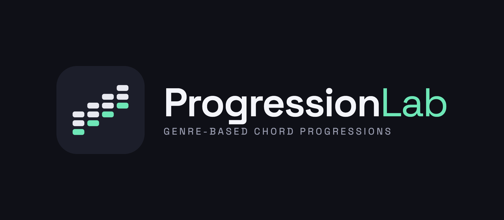

<p align="center">
  
</p>

[](https://github.com/EliA437/progression-lab/actions)

**Progression Lab** is an open-source chord progression plugin (VST3 / AU / CLAP / Standalone) built with [JUCE](https://juce.com). Pick a genre, a key and a length, and it generates a chord progression you can preview and drag straight into your DAW as MIDI.

> [!NOTE]
> Progression Lab is in early development. The plugin builds and loads in FL Studio, but the generator and UI described below are still being built. See [`docs/ROADMAP.md`](docs/ROADMAP.md) for the plan.

## What it does (planned for v1)

- **Generate by genre.** Choose a genre (lo-fi, pop, jazz, and more), a key and a length, and get a progression that sounds like that genre.
- **Preview in the plugin.** A built-in synth plays the progression so you can audition it without leaving the plugin.
- **Drag into your DAW.** Drag the result onto a MIDI track as a `.mid` clip, then use it with any instrument.
- **Teach it your taste.** Keep or discard results to train a genre toward what you like.
- **Make your own genres.** Create a genre from sample chords, and blend genres together.

## How it works

- Chords are stored **relative to the key** (semitones above the tonic plus a chord quality), so any progression can be played in any key. Roman numerals are only used for display.
- Generation uses a **variable-order Markov model with backoff**, not a neural network. Blending genres is a weighted mix of each genre's next-chord probabilities.
- Stock genres come from a SQLite database (`base.db`) built **offline** by a Python pipeline from public chord datasets and hand-written seed progressions. Python never ships to users; the plugin itself is pure C++.
- User data (kept progressions, custom genres) lives in a separate `user.db` that updates never overwrite.

## Building from source

Requires CMake 3.25+, Ninja and a C++23 compiler. Clone with submodules:

```bash
git clone --recurse-submodules https://github.com/EliA437/progression-lab.git
cd progression-lab

# configure (rerun only when CMakeLists.txt changes)
cmake -B build -G Ninja -DCMAKE_BUILD_TYPE=Debug
# build
cmake --build build
# run the tests
ctest --test-dir build --output-on-failure
```

The Standalone app is the quickest way to see the UI. On macOS the build also copies the plugin formats into `~/Library/Audio/Plug-Ins`.

## Project layout

| Folder | Contents |
| --- | --- |
| `source/` | The C++ plugin. `engine/` (generator, blending, voicing), `data/` (SQLite), `midi/` (MIDI export, chord parsing) |
| `tests/`, `benchmarks/` | Catch2 tests and benchmarks |
| `pipeline/`, `data/` | Offline Python data pipeline, seed progressions and the built database |
| `docs/` | The full build plan in [`ROADMAP.md`](docs/ROADMAP.md) |

## Credits

Built from the [Pamplejuce](https://github.com/sudara/pamplejuce) template by Sudara Williams, which provides the CMake setup, CI and packaging. Also uses [JUCE](https://github.com/juce-framework/JUCE), [Catch2](https://github.com/catchorg/Catch2), [pluginval](https://github.com/Tracktion/pluginval) and [Melatonin Inspector](https://github.com/sudara/melatonin_inspector).

## License

See [`LICENSE`](LICENSE).
